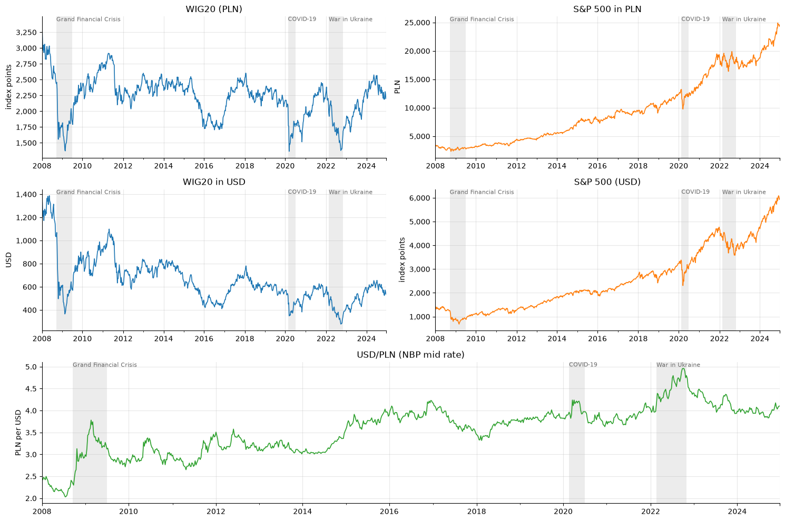
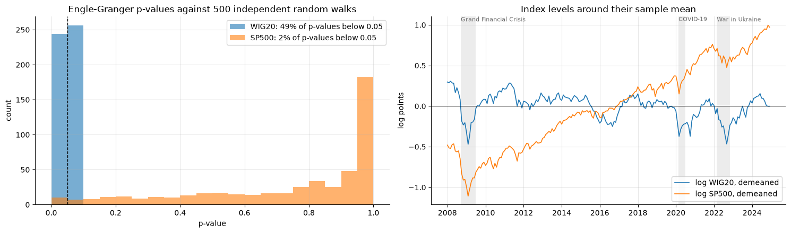
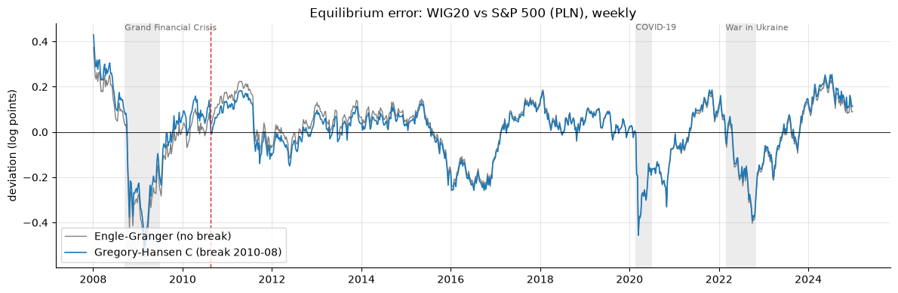

# Stock markets and macro fundamentals: a cointegration analysis of WIG20 and S&P 500 (2008–2024)

[](https://colab.research.google.com/github/igazys/wig20-sp500/blob/main/WIG20_SP500_cointegration.ipynb)

**Do stock indices share long-run equilibrium relationships with the real economy, with economic policy uncertainty
and with each other?** The project tests this for an emerging market (Poland, WIG20) and a developed market
(USA, S&P 500) on monthly, quarterly and weekly data from public APIs and official statistics.

*Extended from my bachelor's thesis (University of Warsaw, Faculty of Economic Sciences, 2025), originally written in R.*

**Tools:** Python · pandas · NumPy · statsmodels · arch · SciPy · matplotlib · REST APIs (NBP, Eurostat, FRED, BLS, Yahoo Finance)



## Why cointegration

Stock indices, GDP, unemployment and exchange rates all trend. Regressing one trending series on another gives a high R²
and "significant" coefficients even when the series are unrelated: the **spurious regression** problem
(Granger & Newbold, 1974). In this dataset a naive levels regression calls **11 of 12** relationships significant, and
Durbin-Watson is below 0.5 in 10 of them. Cointegration tests keep only relationships in which the series share a common
stochastic trend and cannot drift apart permanently.

## Method

| Step | What it does |
|---|---|
| **Unit-root tests** | ADF, KPSS, Zivot-Andrews (one break), DF-GLS and Phillips-Perron classify every series as I(0) or I(1) |
| **Part A: Engle-Granger** | Residual-based cointegration test with MacKinnon (2010) critical values; error-correction models (ECM) with Newey-West standard errors and half-lives |
| **Part B: Gregory-Hansen** | Cointegration with one structural break at an unknown date (level shift, trend, regime shift), implemented from scratch |
| **Part C** | Classifies each relationship: cointegrated in both tests, only with a break, Engle-Granger only, or not at all |
| **Part D: Johansen / VECM** | System cointegration rank per country, adjustment coefficients α, Granger causality, robustness to deterministic terms |
| **Part E: robustness** | WIG20 mean-reversion diagnostics, random-walk and cross-country placebo tests, Johansen restriction test β = (1, 0) |
| **ARDL bounds test** | Pesaran-Shin-Smith (2001) bounds test, valid for I(0) and I(1) regressors, with McNown-Sam-Goh (2018) degenerate-case checks and a bootstrap test on the long-run role of the regressor |

Hypotheses: **H1** indices are cointegrated with macro fundamentals (GDP, inflation, unemployment, interest rate);
**H2** indices are cointegrated with economic policy uncertainty (EPU); **H3** the emerging market (WIG20) depends on the
developed one (S&P 500). Every test decision uses one 5% significance level (`SIGNIF = 0.05`).

## Key findings

**1. Standard tests "confirm" almost everything for WIG20, but the evidence is not robust.** Over 2008–2024 WIG20 has no
trend and reverts to its mean (half-life ≈ 7 months). Against **500 independent random walks**, the Engle-Granger test
finds "cointegration" with WIG20 in **49%** of cases (nominal 5%), and only 2% for the S&P 500. In the Johansen
restriction test, **none of the WIG20 relations** requires the macro variable: each one reduces to WIG20 alone.



**2. The ARDL bounds test separates mean reversion from real long-run links.** For WIG20 the F-test rejects in almost every
pair, but only because WIG20's own lagged level is significant. After the degenerate-case checks, only two Polish
relations remain, both borderline: **unemployment** (bootstrap p = 0.03) and **policy uncertainty** (p = 0.05). On placebo
data the procedure gives 8% false positives, compared with 49% for Engle-Granger. A side finding: `statsmodels.UECM.bounds_test`
uses the critical values for two regressors instead of one, so the notebook applies the correct PSS bounds by hand.

**3. US relations exist only with a structural break.** The S&P 500 appears strongly related to US inflation, interest
rates and unemployment in levels, but none of these pairs is cointegrated: they are spurious. Real GDP (break in 2020)
and EPU (break in February 2022) are cointegrated only under Gregory-Hansen, and the ARDL test finds no long-run relation
for any US pair.

**4. The S&P 500 leads WIG20 in the short run; the long-run link is weak.** S&P 500 returns Granger-cause WIG20 returns
(F = 12.5, p < 0.001), not the reverse (p = 0.31). Weekly Engle-Granger (p = 0.01) and Johansen (r = 1, borderline) find a
relation in which only WIG20 adjusts, but Gregory-Hansen does not, and cointegration holds in only 11% of rolling 3-year
windows. The gap between the two markets opens in every crisis and then closes:



| Hypothesis | WIG20 (Poland) | S&P 500 (USA) |
|---|---|---|
| **H1** macro fundamentals | Not robust: Engle-Granger relations reduce to mean reversion; ARDL supports unemployment only (borderline) | Not supported: GDP only with a 2020 break, rejected by ARDL |
| **H2** policy uncertainty | Weak: ARDL p = 0.05 | Only with a 2022 break |
| **H3** WIG20 depends on S&P 500 | Short run: yes. Long run: weak, unstable over time | — |

## Limitations

- Price indices exclude dividends. A total-return index (WIG20TR) has a clearer upward trend and is a natural
  extension.
- Gregory-Hansen allows one break; the rolling analysis shows some relationships change more than once.
- About 12 pairs are tested with several procedures, so borderline results (p ≈ 0.03–0.06) should be read with multiple
  testing in mind.
- The PSS critical values are asymptotic, which matters most for the quarterly GDP pairs (n = 68).

## Run it

- **Google Colab:** click the badge above and choose *Runtime → Run all*. The first cell clones this repository, so the
  files in `data/input/` are available without uploading anything.
- **Locally:**
  ```bash
  git clone https://github.com/igazys/wig20-sp500.git && cd wig20-sp500
  python3 -m venv .venv
  .venv/bin/pip install -r requirements.txt jupyter
  .venv/bin/jupyter lab WIG20_SP500_cointegration.ipynb
  ```
  Then choose *Kernel → Restart Kernel and Run All*. Later sections use variables created earlier, so run the whole
  notebook rather than single cells.

Results (datasets, figures and every result table in `results.xlsx`) are written to `output/`.

## Data

| Series | Source |
|---|---|
| WIG20, inflation and unemployment (PL, US) | Stooq, files in `data/input/` (Eurostat and BLS APIs as fallback) |
| S&P 500 | Yahoo Finance API (Stooq as fallback) |
| USD/PLN | National Bank of Poland API (Table A mid rate) |
| Real GDP | Eurostat `namq_10_gdp` (Poland, chain-linked 2010 PLN, SA) and FRED `GDPC1` (US); backup copies in `data/input/` |
| Interest rates | NBP reference rate (`REFPL.csv`), Fed funds rate (`FEDFUNDS.csv`, FRED) |
| Policy uncertainty | EPU Poland (Białkowski, Klepka & Sławik, 2025), EPU US (Baker, Bloom & Davis, 2016) |

## Main references

Engle & Granger (1987) · Granger & Newbold (1974) · Gregory & Hansen (1996) · Johansen (1988, 1991) ·
Pesaran, Shin & Smith (2001) · McNown, Sam & Goh (2018) · MacKinnon (2010) · Zivot & Andrews (1992) ·
Baker, Bloom & Davis (2016). The full list is at the end of the notebook.

## License

Code: MIT (see `LICENSE`). Data files remain subject to the terms of their original providers.
